# Proiectul A, pas cu pas: „Cine răspunde la campania de marketing?”

> Fiecare pas răspunde la trei întrebări: **Ce fac? – De ce? – De ce nu altceva?** Cifrele sunt cele obținute la rularea notebook-ului `ProiectA_Partea_A.ipynb`.

---

## Pe scurt (de reținut în 30 de secunde)

- **Date:** 2240 de clienți ai unui magazin (setul *Customer Personality Analysis*, Kaggle), 29 de coloane.
- **Întrebarea 1 (principală):** va accepta clientul oferta din campanie? → **clasificare**. Model ales: **Regresia Logistică**, ROC-AUC **0,89** pe test, găsește **~3 din 4** clienți interesați.
- **Întrebarea 2:** câți bani cheltuie un client? → **regresie**. Model ales: **Random Forest Regressor**, R² **0,88**.
- **Cele două capcane evitate:** clasele dezechilibrate (doar 15% răspund) și data leakage.

---

## Pasul 1. Formularea problemei

**Context:** magazinul a trimis o campanie de marketing. Coloana `Response` = 1 dacă clientul a acceptat oferta, 0 altfel.

**Problema:** clasificare binară supervizată – pe baza datelor despre client prezicem dacă va răspunde.

**De ce e utilă:** dacă știm dinainte cine are șanse mari să răspundă, trimitem oferta doar lor → **costuri mai mici** și **mai puțini clienți deranjați**.

**De ce clasificare și nu altceva?** Ținta are doar două valori (da/nu) și avem eticheta pentru fiecare client.

### Coloanele setului de date (pe înțeles)

| Grup | Coloane | Ce înseamnă |
|---|---|---|
| Cine e clientul | `Year_Birth`, `Education`, `Marital_Status`, `Income`, `Kidhome`, `Teenhome` | anul nașterii, studii, stare civilă, venit anual, copii mici / adolescenți acasă |
| Relația cu magazinul | `Dt_Customer`, `Recency`, `Complain` | data înscrierii, zile de la ultima cumpărătură, dacă s-a plâns |
| Cât cheltuie (2 ani) | `MntWines`, `MntFruits`, `MntMeatProducts`, `MntFishProducts`, `MntSweetProducts`, `MntGoldProds` | sume cheltuite pe vin, fructe, carne, pește, dulciuri, aur |
| Unde cumpără | `NumWebPurchases`, `NumCatalogPurchases`, `NumStorePurchases`, `NumDealsPurchases`, `NumWebVisitsMonth` | nr. cumpărături online / catalog / magazin / cu reducere, vizite pe site pe lună |
| Campanii anterioare | `AcceptedCmp1` … `AcceptedCmp5` | 1 dacă a acceptat campania respectivă |
| Ținta | `Response` | 1 dacă a acceptat ultima campanie |
| Inutile | `ID`, `Z_CostContact`, `Z_Revenue` | identificator și două coloane constante → eliminate |

---

## Pasul 2. Analiza exploratorie (EDA)

**Ce am găsit:**
- doar `Income` are valori lipsă: **24 din 2240** (~1%) → le completăm în pipeline;
- `Z_CostContact` și `Z_Revenue` au o singură valoare → nu aduc informație → eliminate;
- **doar 14,9% dintre clienți au răspuns** (334 din 2240) → clase dezechilibrate.

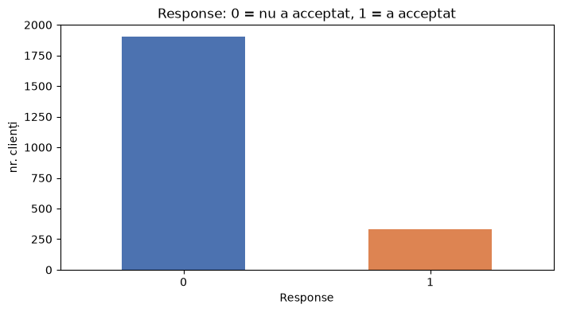

**Consecință:** un model care spune mereu „nu” ar avea 85% acuratețe și ar fi inutil → **acuratețea nu e o metrică bună aici**.

### Valori aberante (erori în date)

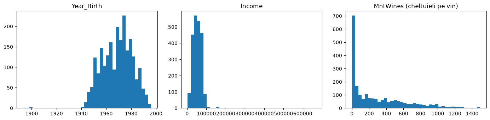

- 3 clienți „născuți” în 1893, 1899, 1900 → erori de introducere;
- un venit de 666.666 → eroare evidentă;
- cheltuielile sunt foarte asimetrice (mulți cheltuie puțin, puțini mult) – normal în vânzări.

**Decizie:** eliminăm aceste 4 rânduri imposibile. Sunt reguli de bun simț, nu statistici calculate pe date → nu produc data leakage.

### Cine răspunde?

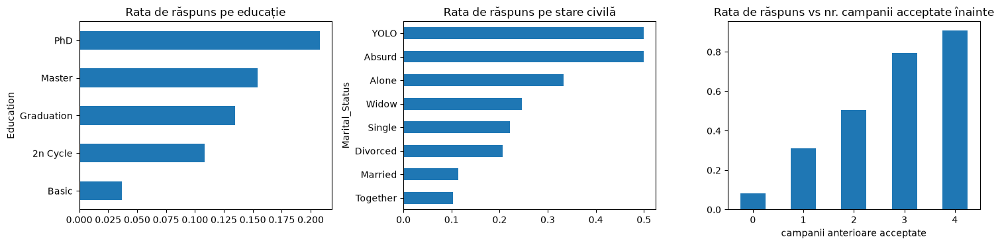

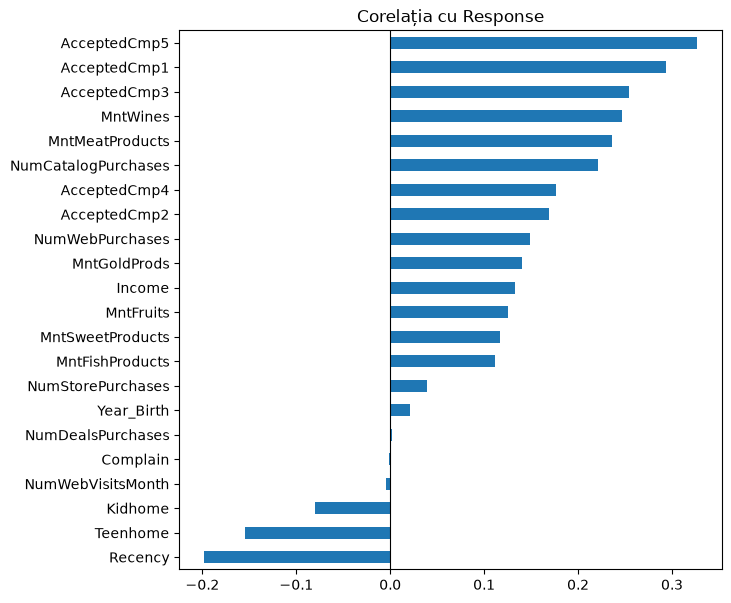

**Ce am aflat:**
- clienții care **au acceptat campanii anterioare** răspund mult mai des (cel mai puternic semnal);
- cei care cheltuie mult (vin, carne, catalog) și au venit mare răspund mai des;
- `Recency` e corelat **negativ**: clienții care au cumpărat recent răspund mai des;
- clienții cu copii acasă răspund mai rar;
- `Single`/`Divorced`/`Widow` răspund mai des decât `Married`/`Together`;
- categoriile `Alone`, `Absurd`, `YOLO` au 2–3 persoane → grupate în `Other`.

---

## Pasul 3. Curățare și atribute noi

Doar transformări **rând cu rând** (nu folosesc statistici din tot setul) → sigure față de data leakage.

| Atribut nou | Cum se calculează | De ce |
|---|---|---|
| `Age` | 2014 − `Year_Birth` | vârsta e mai intuitivă decât anul |
| `Customer_Days` | zile de la înscriere până la 31.12.2014 | modelul nu poate folosi direct o dată calendaristică |
| `Children` | `Kidhome` + `Teenhome` | total copii |
| `MntTotal` | suma celor 6 coloane `Mnt*` | cât cheltuie în total |
| `TotalPurchases` | web + catalog + magazin | câte cumpărături |
| `PrevAccepted` | suma `AcceptedCmp1…5` | câte campanii a acceptat înainte |

**Rezultat:** 4 rânduri eliminate → **2236 clienți**, 30 de coloane.

---

## Pasul 4. Împărțirea train/test și pipeline-ul

- **80% train (1788 clienți), 20% test (448 clienți)**, stratificat: ambele au ~15% clienți care răspund.
- **Testul e folosit o singură dată, la final.** Toate deciziile se iau pe train, cu 5-fold cross-validation.

### Pipeline-ul de preprocesare

| Tip coloană | Pas | De ce | De ce nu altceva |
|---|---|---|---|
| numerice (27) | `SimpleImputer(median)` | completează cele 24 de venituri lipsă | mediana e robustă la extreme; nu ștergem rânduri ca să nu pierdem date |
| numerice | `StandardScaler` | toate coloanele la medie 0, deviație 1 | SVM și Regresia Logistică depind de mărimea numerelor |
| categoriale (2) | `OneHotEncoder` | text → coloane 0/1 | codificarea 0,1,2,3 ar inventa o ordine falsă |

Din 29 de coloane rezultă **38** (27 numerice + 5 pentru educație + 6 pentru starea civilă), fără nicio valoare lipsă.

**Exemplu pe un client real:** venit 57.136 → **0,244** (puțin peste media de 51.948); `Recency` 18 zile → **−1,071** (a cumpărat mult mai recent decât media de 49 de zile); `Education = Graduation` → coloana `Education_Graduation = 1`, celelalte 0.

### Cum am evitat data leakage
1. împărțirea train/test **înainte** de orice pas care învață din date;
2. preprocesarea **în același pipeline cu modelul** → mediana și scalarea se calculează doar pe partea de antrenare a fiecărui fold;
3. dacă am fi scalat tot setul înainte de împărțire, mediile ar fi conținut informație din test = leakage.

### Cross-validation
`StratifiedKFold` cu **k = 5**. De ce nu un singur set de validare? Cu ~330 de pozitive, un singur split ar fi „norocos” sau „ghinionist”. De ce 5 și nu 10? Compromis între stabilitate și timp de calcul.

---

## Pasul 5. Tratarea dezechilibrului

Aceeași Regresie Logistică, trei variante, evaluate cu 5-fold CV pe train:

| Variantă | ROC-AUC | F1 | Recall | Precizie |
|---|---|---|---|---|
| Fără tratare | 0,903 | 0,588 | **0,505** | 0,707 |
| `class_weight="balanced"` | 0,904 | 0,584 | **0,805** | 0,458 |
| SMOTE | 0,901 | 0,595 | 0,798 | 0,474 |

**Interpretare:**
- ROC-AUC rămâne la fel → capacitatea modelului de a **ordona** clienții nu se schimbă;
- se schimbă **pragul de decizie**: fără tratare găsim doar jumătate din clienții interesați; cu tratare găsim **80%**, cu prețul a mai multe oferte trimise degeaba;
- pentru marketing, a rata un client interesat costă mai mult decât un email în plus → preferăm **recall mare**.

**Decizia:** `class_weight="balanced"` – rezultate ca SMOTE, dar mai simplu (fără date artificiale, fără pas în plus).

---

## Pasul 6. Modelele și alegerea hiperparametrilor (Grid Search + 5-fold CV)

| Model | De ce l-am ales | Ce am reglat |
|---|---|---|
| **Regresie Logistică** | simplu, liniar, interpretabil – punct de referință | `C` (puterea regularizării) |
| **SVM (kernel RBF)** – obligatoriu | granița cu marginea maximă; RBF permite granițe curbe | `C`, `gamma`, kernel (rbf / linear) |
| **Random Forest** – ansamblu, obligatoriu | sute de arbori care votează; prinde interacțiuni | `max_depth`, `min_samples_leaf` |
| Dummy | ghicește după proporții | – (doar referință) |

Metrica după care alegem: **ROC-AUC** (nu depinde de prag, funcționează cu clase dezechilibrate).

### Rezultate în cross-validation (pe train)

| Model | ROC-AUC CV | ± std | Cei mai buni parametri |
|---|---|---|---|
| Regresie Logistică | **0,904** | 0,019 | C = 1 |
| SVM | 0,902 | 0,019 | RBF, C = 10, gamma = 0,001 |
| Random Forest | 0,894 | 0,004 | max_depth = None, min_samples_leaf = 1, 300 de arbori |
| Dummy | 0,494 | 0,017 | – |

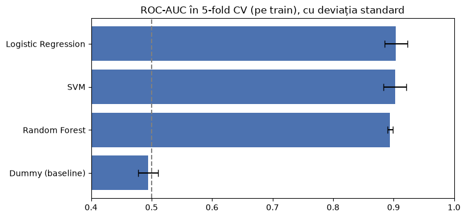

**Interpretare:** toate modelele sunt mult peste Dummy (0,5 = la întâmplare). Diferențele dintre ele sunt mai mici decât deviația standard → niciun model nu e net superior. Faptul că Regresia Logistică ține pasul arată că relația e **aproape liniară**.

---

## Pasul 7. Evaluarea finală pe setul de test (folosit o singură dată)

| Model | ROC-AUC | PR-AUC | Recall | Precizie | F1 | Acuratețe |
|---|---|---|---|---|---|---|
| **Regresie Logistică** | **0,892** | 0,614 | **0,761** | 0,440 | 0,557 | 0,819 |
| SVM | 0,890 | 0,620 | 0,761 | 0,447 | 0,564 | 0,824 |
| Random Forest | 0,883 | 0,603 | 0,478 | 0,604 | 0,533 | **0,875** |
| Dummy | 0,513 | 0,153 | 0,179 | 0,171 | 0,175 | 0,748 |

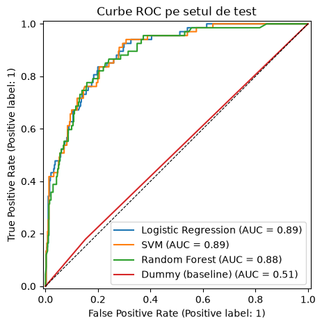

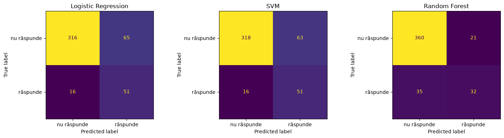

**Cum citim matricea de confuzie (Regresia Logistică, 448 de clienți de test):**
- **51** clienți care au răspuns și i-am găsit ✔
- **16** clienți care ar fi răspuns, dar i-am ratat (cea mai gravă greșeală)
- **65** oferte trimise degeaba (greșeală ieftină – un email)
- **316** clienți corect lăsați deoparte ✔

Random Forest ratează **35** din 67 de clienți interesați – de aceea, deși are cea mai mare acuratețe, e cel mai slab pentru scopul nostru.

---

## Pasul 8. Comparația modelelor

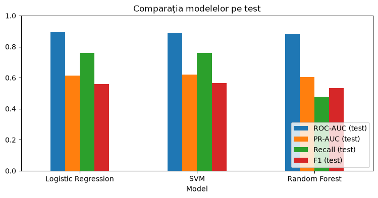

- **Scorul pe test (0,89) ≈ scorul din CV (0,90)** → estimarea a fost corectă, nu avem overfitting puternic și nici leakage.
- **Regresia Logistică și SVM sunt la egalitate.** Diferența de 0,002 e mult sub deviația standard (~0,02).
- **Random Forest** are recall mic (~0,48): arborii adânci memorează train-ul și spun „da” rar.
- **Dummy** are 75% acuratețe, dar ROC-AUC 0,5 → dovada că acuratețea e înșelătoare.

**Modelul ales: Regresia Logistică (C = 1, class_weight = balanced).** Aceleași scoruri ca SVM, dar mai simplă, mai rapidă și **explicabilă** unui manager de marketing.

---

## Pasul 9. Ce atribute contează?

**Permutation importance** pe test: amestecăm o coloană și vedem cât scade ROC-AUC.

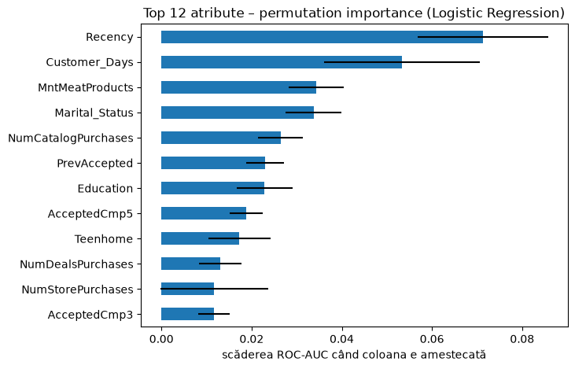

| Atribut | Scăderea ROC-AUC |
|---|---|
| `Recency` | 0,071 |
| `Customer_Days` | 0,053 |
| `MntMeatProducts` | 0,034 |
| `Marital_Status` | 0,034 |
| `NumCatalogPurchases` | 0,026 |
| `PrevAccepted` | 0,023 |
| `Education` | 0,023 |

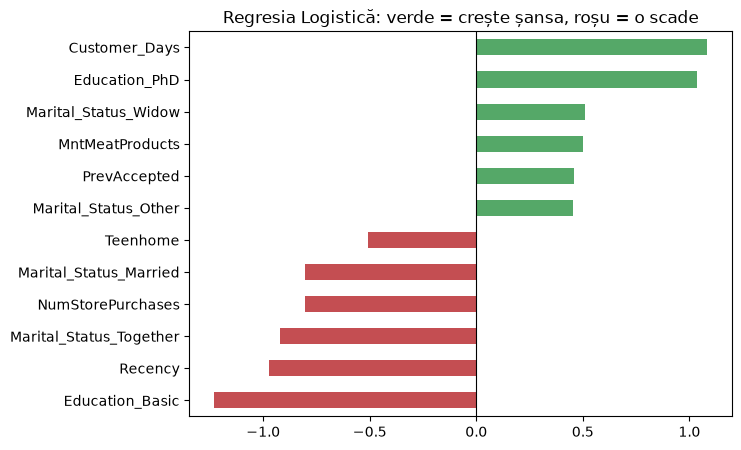

**În limbaj de business – clientul ideal pentru ofertă:**
- **a cumpărat recent** (cel mai important factor);
- **e client vechi** al magazinului;
- **cheltuie mult pe carne** și **cumpără din catalog**;
- **a mai acceptat campanii** înainte;
- e **necăsătorit / divorțat / văduv** și mai probabil cu **doctorat**; cei cu studii de bază, căsătoriți sau cu adolescenți acasă răspund mai rar.

Rezultatele confirmă EDA → modelul e coerent cu intuiția.

---

## Pasul 10. Cât de sigure sunt rezultatele?

### 10.1 Senzitivitatea la hiperparametri

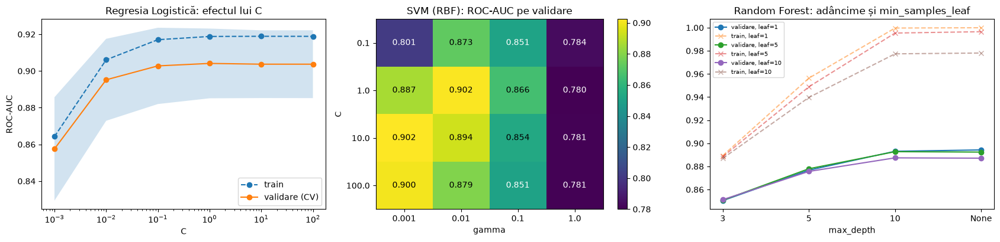

- **Regresia Logistică:** cu C foarte mic e prea simplă (0,858); de la C ≈ 0,1 scorul se stabilizează la ~0,904; train și validare rămân apropiate → **nu face overfitting**.
- **SVM:** cel mai sensibil. Cu `gamma = 1` scorul cade la ~0,78 (memorează punctele). Zona bună e o diagonală (C = 1 cu gamma = 0,01 sau C = 10 cu gamma = 0,001 → ~0,90). Kernelul liniar dă 0,899 → relația e aproape liniară.
- **Random Forest:** pe train ajunge la **1,0** (memorează), pe validare doar ~0,89 → **overfitting** clar.

### 10.2 10 împărțiri diferite ale datelor

Am repetat împărțirea + antrenarea cu **10 seed-uri diferite**:

| Model | ROC-AUC | Recall | Precizie | F1 |
|---|---|---|---|---|
| Regresie Logistică | 0,892 ± 0,010 | 0,791 ± 0,032 | 0,448 ± 0,021 | 0,571 ± 0,021 |
| SVM | 0,892 ± 0,010 | 0,784 ± 0,039 | 0,450 ± 0,026 | 0,571 ± 0,028 |
| Random Forest | 0,891 ± 0,018 | 0,548 ± 0,081 | 0,612 ± 0,070 | 0,574 ± 0,062 |

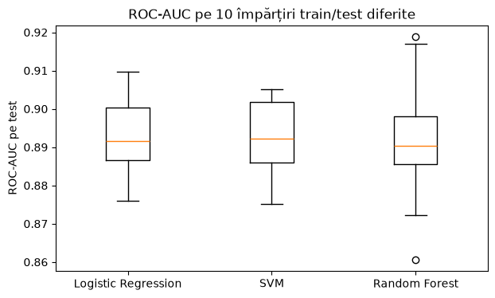

**Concluzie:** diferențele dintre modele sunt mai mici decât variația de la o împărțire la alta. Random Forest e de 2–3 ori mai instabil la recall.

### 10.3 Experimente „cu / fără” (ablație)

| Experiment | ROC-AUC | Recall | F1 |
|---|---|---|---|
| SVM complet (ales) | 0,902 | 0,779 | 0,579 |
| SVM **fără scalare** | **0,623** | **0,067** | 0,122 |
| SVM **fără class_weight** | 0,898 | **0,371** | 0,510 |
| LogReg complet (ales) | 0,904 | 0,805 | 0,584 |
| LogReg fără atributele noi | 0,904 | 0,805 | 0,583 |

- **Scalarea e esențială pentru SVM** – fără ea, venitul domină și modelul aproape nu mai învață;
- **class_weight dublează recall-ul** fără să schimbe ROC-AUC;
- **atributele noi** nu au schimbat scorul – informația exista deja în coloanele originale.

### 10.4 Clienți duplicați

74 din 448 de rânduri de test (~16%) apar identic și în train. Fără ele, ROC-AUC **crește** de la 0,890 la 0,909 → duplicatele **nu umflă** rezultatele.

---

## Pasul 11. A doua întrebare: cât cheltuie un client? (regresie)

Ținta: `MntTotal` (suma cheltuită pe 2 ani). **Anti-leakage:** am scos toate coloanele `Mnt*` din atribute (ținta e chiar suma lor) și `Response`.

| Model | MAE CV | MAE test | RMSE test | R² test |
|---|---|---|---|---|
| **Random Forest Regressor** | 110,7 | **108,1** | 208,1 | **0,883** |
| SVR (C = 1000, gamma = 0,03) | 118,0 | 126,0 | 233,9 | 0,853 |
| Ridge (liniar, alpha = 100) | 173,3 | 172,6 | 272,2 | 0,801 |
| Dummy (media) | 515,6 | 516,6 | 609,5 | 0,000 |

Cheltuiala medie a unui client din test: **604,8**.

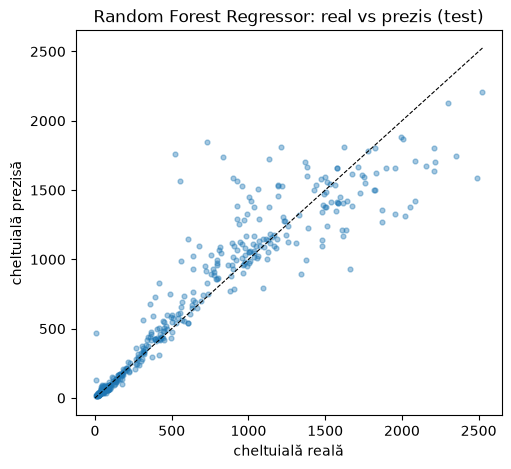

- Random Forest greșește în medie cu **~108** (față de 517 la Dummy) și explică **88%** din diferențele dintre clienți.
- Aici relația **nu e liniară** → ansamblul câștigă clar față de Ridge.
- Cele mai importante atribute: **numărul total de cumpărături**, **venitul**, **cumpărăturile din catalog**.
- Atenție: numărul de cumpărături e măsurat în aceeași perioadă ca cheltuiala → predictor „ușor”.
